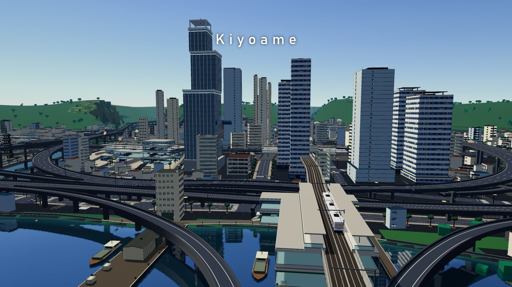
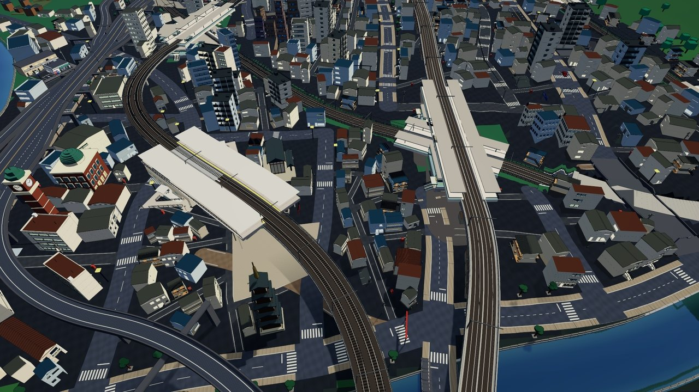
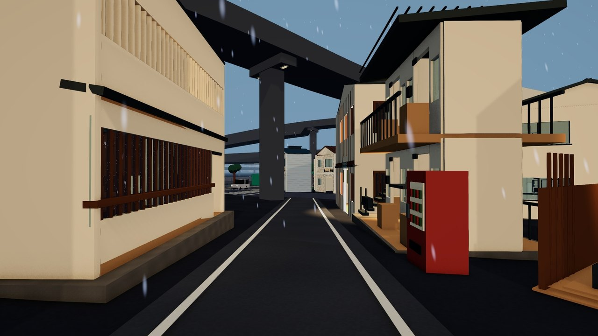
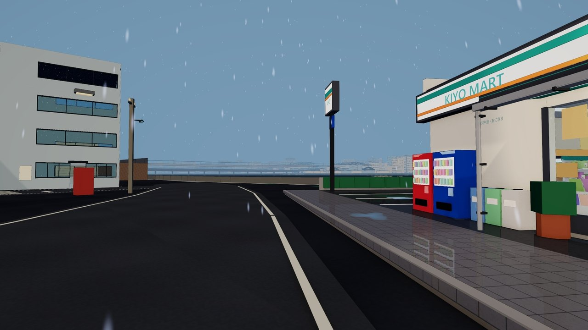
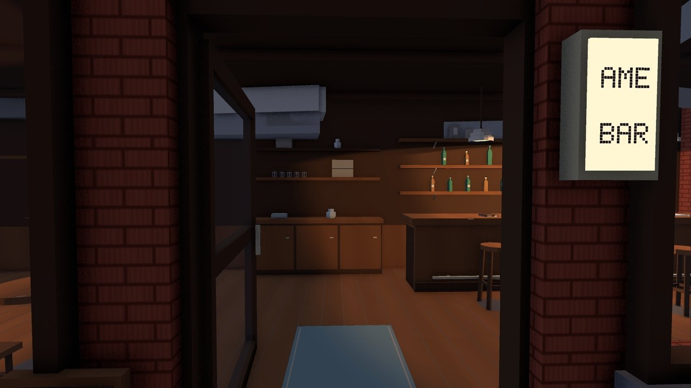
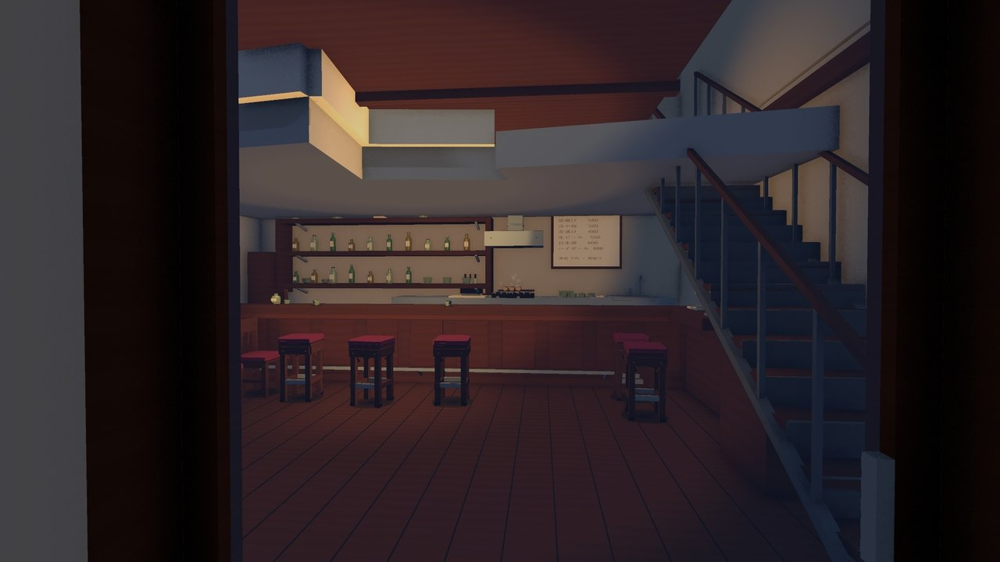
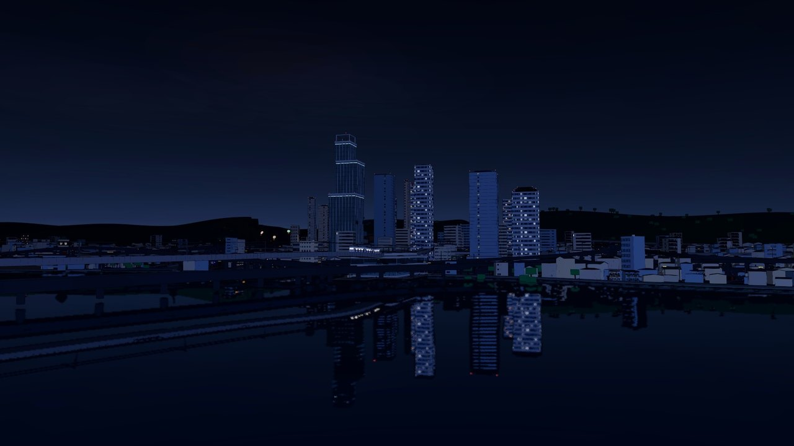
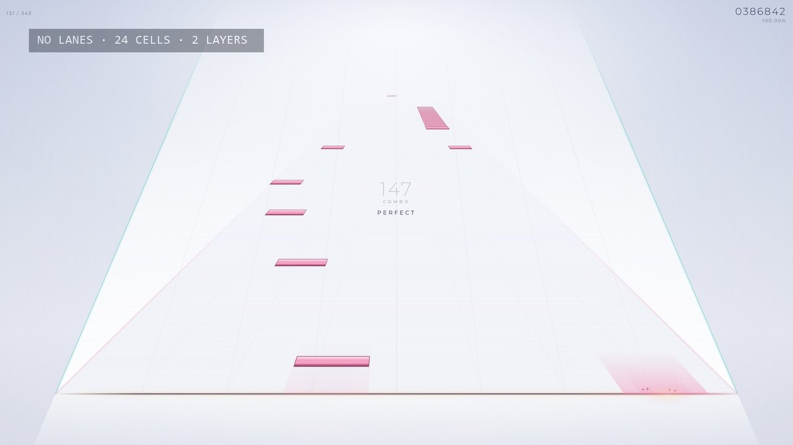

# Kiyoame



**Kiyoame** is a work-in-progress game that mixes a small open world with a rhythm game. You explore Kiyoame, a rainy Japanese harbour town with a bay, a river and hills to the north, and play its music in a two-layer rhythm mode with no lanes.

The game is built in Unity 6 (URP) with a cel-shaded look. This repository holds the **demo video** and a **playable web prototype** of the rhythm mode.

**[Play the web prototype in your browser](https://buchunneku-dot.github.io/kiyoame-demo/)** · **[Watch the demo video](https://github.com/buchunneku-dot/kiyoame-demo/releases/latest)**

## Demo video

The 54-second demo is attached to the [latest release](https://github.com/buchunneku-dot/kiyoame-demo/releases/latest). It was captured in engine and shows the town by day and by night, a few interiors, and two stretches of rhythm play.

| | | |
|---|---|---|
|  |  |  |
|  |  |  |

## Web prototype



The rhythm mode as a single web page, with one song: **Kiyoame Theme** (120 BPM, about 1:30).

### Start playing

- Play online at **https://buchunneku-dot.github.io/kiyoame-demo/**.
- Or download this repository and open [`play/index.html`](play/index.html) in a desktop or mobile browser. It is one self-contained file with the music built in, so no server or install is needed.
- Chrome, Edge, Firefox and Safari all work. Play in landscape, and use headphones if you can.

On the home screen, pick a chart and press **Start**:

| Chart | Notes | For |
|---|---|---|
| **Standard** | 247 | A first play: the melody plus light decoration. |
| **Showcase** | 351 | The full arrangement: chords, short stairs, hand-to-hand runs and sixteenths in the choruses. |

### Controls

The game uses a **mouse or a touch screen**. There is no keyboard input.

- The field is one wide strip with no lanes, split into **24 cells** across. A note covers a range of cells, and you hit it by touching anywhere inside that range when it reaches the **judgement line** at the bottom.
- Notes fall on **two layers**: the lower layer (pink) usually carries the melody, and the upper layer (teal) carries the arrangement around it. Both layers meet at the same line, so you play them with the same hand movements.
- With a mouse you have one "finger". With a touch screen you can use as many fingers as you like. Neither chart ever needs more than two at once.

### Notes

| Note | What to do |
|---|---|
| **Tap** | Press when it reaches the line. |
| **Hold** | Press at the start and keep a finger inside the range until the end. You can switch fingers or slide around, as long as one stays inside. |
| **Slide** | Like a Hold, but the range moves. Follow it. |
| **Drag** (yellow) | Just touch it. A finger resting or sweeping through the range counts, and every touch is PERFECT. |
| **Flow** | A long band scored in ticks. Keep a finger inside it; on the scrub kind, rub back and forth across it. |
| **Ex** notes (gold outline) | Ex Tap, Ex Hold, Ex Slide and Ex Flow work like the plain notes with a more forgiving timing window. |
| **Linked pair** | Two notes at the same moment, one on each layer, joined by a yellow line. Hit both. |

### Judgement and score

| Grade | Timing |
|---|---|
| PERFECT | within ±60 ms |
| GREAT | within ±100 ms |
| GOOD | within ±150 ms |
| MISS | later or not hit |

The score goes up to 1,000,000. The result screen shows accuracy, max combo and the grade counts for each layer.

### Settings

- **Scroll speed**, set separately for the upper and lower layers, or locked together.
- **Background**: mist or dark.
- **Touch area**: only near the line, the lower half of the screen, or the full screen.
- **Grid lines**: lane width, every cell, or off.
- **Auto play**: watch a chart played perfectly.

## Repository layout

```
play/index.html    the playable page
src/               the same page as separate files, plus tests
media/             images for this README
```

To work from the separate files, serve the repository over http (for example `python -m http.server`) and open `src/trackless.html`. To rebuild `play/index.html` from `src/`:

```
python src/build.py
```

To run the tests (Node.js 18 or later):

```
node src/tests/trackless-core.test.js
node src/tests/song.test.js
node src/tests/projection.test.js
node src/tests/trackless-touch.test.js
node src/tests/trackless-audio.test.js
```

## Music

Kiyoame Theme is an original soundtrack for this game.

## License

Copyright © 2026 buchunneku-dot. All rights reserved. See [LICENSE](LICENSE).
