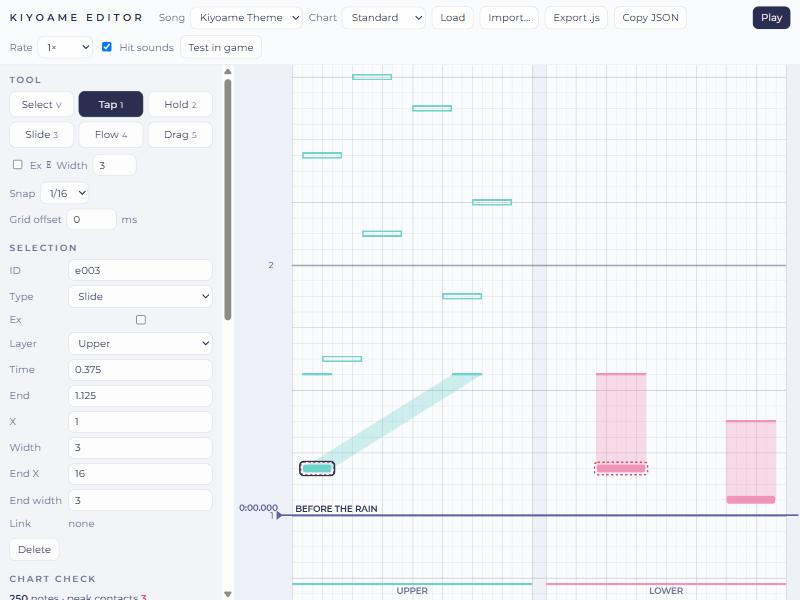

# Chart Editor

The chart editor ([`play/editor.html`](../play/editor.html), [online](https://buchunneku-dot.github.io/kiyoame-demo/play/editor.html)) builds and checks two-layer charts in the same format the game plays. It runs in a desktop browser with a mouse and keyboard.

## Layout

- **Top bar:** song and chart to load, import and export, playback, and test play in the game.
- **Left panel:** tools, snap, the selected note's properties, the chart check, chart details and a key list.
- **Timeline:** the upper layer on the left, the lower layer on the right, both 24 cells wide. Time runs upward. Bar numbers are on the ruler, section names on the bar lines, and the playhead is the blue line.

## Making notes

| Tool | Key | Click | Drag |
|---|---|---|---|
| Select | V / Esc | Select a note | Box-select on empty space |
| Tap | 1 | Tap at the default width | Sideways sets the range |
| Hold | 2 | Hold one snap line long | Sideways sets the range, up sets the end |
| Slide | 3 | Slide one snap line long | Up sets the end, sideways sets where it ends |
| Flow | 4 | Hold-mode Flow, one tick long | Sideways sets the range, up sets the end |
| Drag | 5 | Drag at the default width | Sideways sets the range |

- **Ex** (E) makes new notes Ex; with notes selected, E toggles Ex on them.
- **Snap** sets the grid from 1/4 to 1/32 notes, or off (millisecond steps). **Grid offset** shifts the grid for songs whose first beat is not at 0.
- The **layer** is set by the column you click in.

## Editing

- Click a note to select it; Shift-click adds to the selection. Ctrl+A selects all.
- Drag a note to move it in time and across cells. Drag the top edge of a long note to change its end; for a Slide, the top edge also moves where the path ends.
- Arrow keys nudge the selection by one snap line or one cell.
- Right-click or Delete removes notes.
- **L** links one upper and one lower note: their ranges must overlap, and the second note moves to the first one's time. **U** unlinks. Moving one half of a pair to another time unlinks it.
- Ctrl+C copies, Ctrl+V pastes at the playhead; pasted pairs stay linked.
- Ctrl+Z / Ctrl+Y undo and redo.
- The properties panel edits any field directly: type, Ex, layer, time, end, range, Slide end range, Flow mode and tick.

## Checking

The **chart check** panel updates after every edit and reuses the game's own rules:

- note count and the peak number of contacts at once;
- validation errors, which block auto play and export use;
- chart warnings (contact limit, brushing, unlinked overlaps, layer hints);
- the auto play score, which must be 1,000,000.

Notes with errors get a solid red outline, notes with warnings a dashed one. Clicking a problem selects its notes and moves the view to them. Rules are listed in [Chart Validation](ChartValidation.md).

## Listening and testing

- **Space** or **Play** plays the song from the playhead, with a hit sound for every note. **Rate** slows playback to 0.75× or 0.5×. Click the ruler to move the playhead.
- **Test in game** opens the game with the current chart, starting two seconds before the playhead. The song and chart pickers are hidden in this mode. It needs a chart with no errors.

## Files

- **Load** opens a shipped chart, or a new blank chart for the selected song.
- **Import** reads a `.json` chart or a chart script.
- **Export .js** saves a chart script in the shipped format. **Copy JSON** copies the chart as JSON.
- The editor saves a draft in the browser after every edit and restores it on the next visit.
- Loading and exporting a shipped chart reproduces it exactly.

## Code

| File | Role |
|---|---|
| `src/editor/editor-model.js` | Editing logic with no page code: notes, links, undo, paste, checks, export |
| `src/editor/editor-view.js` | Timeline drawing and hit testing |
| `src/editor/editor.js` | Input, panels, playback, files |
| `src/tests/editor-model.test.js` | Tests for the editing logic, including the exact round trip of every shipped chart |
