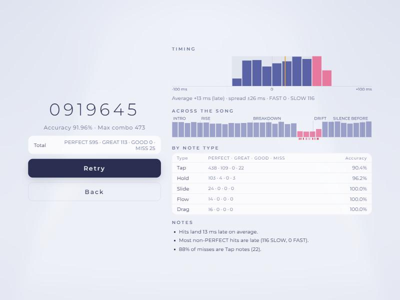

# Core Gameplay

## Field

- One strip, **24 cells** wide, with no lanes. A note covers a range of whole cells, at least one cell wide.
- A note is hit by touching anywhere inside its range when it reaches the **judgement line** at the bottom.
- Notes fall in perspective toward the line. Scroll speed is set per layer, from 1.0 to 20.0.

**Why no lanes.** Lanes tie every note to a fixed key. A free strip lets a chart draw the music: a rising line climbs across the field, a chord spreads wide, a quiet passage stays narrow. The judge then has to decide which touch belongs to which note; those rules are in [Judgement and Scoring](JudgementAndScoring.md).

## Two layers

| Layer | Colour | Usually carries |
|---|---|---|
| Lower | Pink | The melody: taps and holds |
| Upper | Teal | The arrangement: slides, drags, flows and accents |

Both layers end at the same line and share the same field. They are separate in reading, not in playing: a lower and an upper note in the same place at the same moment need two fingers, and the chart marks them as a **linked pair**.

## Note types

| Note | Action | Scored as |
|---|---|---|
| **Tap** | Press as it reaches the line | One timed hit |
| **Hold** | Press and keep a finger inside until the end; fingers may switch | Start, then a checkpoint every eighth note |
| **Slide** | Like a Hold, but the range moves; follow it | Start, then checkpoints along the path |
| **Flow, hold** | Keep a finger inside a long band | Start, then ticks |
| **Flow, scrub** | Rub back and forth across the band | Start, then ticks that need movement |
| **Drag** | Touch or sweep through it at any point near its time | Always PERFECT within ±150 ms |
| **Ex** variants | Same actions, gold outline | PERFECT anywhere within ±100 ms |
| **Linked pair** | One upper and one lower note at the same moment, joined by a yellow line | Two hits, two fingers |

Note colour follows the layer, except Drags, which are yellow. Ex notes add a gold outline.

## Input

- **Touch:** any number of fingers. No chart needs more than two at once.
- **Mouse:** one finger.
- **Touch area:** near the line, the lower half (default) or the full screen. Touches outside it, at the very edge of the screen, or as wide as a palm are ignored.
- Touch timing uses the time the touch happened, not when the page handled it, and the device's audio delay is compensated.

## Charts

Each song has two charts.

| Song | BPM | Length | Chart | Notes | Design |
|---|---|---|---|---|---|
| Kiyoame Theme | 120 | 1:31 | Standard | 247 | The melody with light decoration; a first play |
| | | | Showcase | 351 | The full arrangement: chords, short stairs, hand-to-hand runs, sixteenths in the choruses |
| Ams | 136 | 2:30 | Standard | 454 | Kicks and snares in eighths, holds in calm sections, slides before the last drop |
| | | | Showcase | 620 | Denser drops, sixteenth pairs, hand-to-hand runs into each drop |

Every chart passes validation and the chart check, never needs more than two fingers, and scores 1,000,000 on auto play. Charts are built from the song's measured tempo and beat grid, and follow its sections (intro, rises, drops, breakdowns).

## Score and results

- Score from 0 to 1,000,000; accuracy; max combo; PERFECT / GREAT / GOOD / MISS counts per layer.
- **Timing:** a histogram of hit offsets from −100 to +100 ms, with the PERFECT zone shaded and the mean marked; the average offset, spread and FAST / SLOW counts.
- **Across the song:** accuracy in 32 slices of the song with section names, and a mark for every miss.
- **By note type:** grade counts and accuracy for Tap, Hold, Slide, Flow and Drag.
- **Notes:** up to three findings, for example a steady late bias, the most-missed kind of note, the weakest section, or a weaker layer.

## Settings

| Setting | Options |
|---|---|
| Scroll speed | 1.0–20.0, per layer or locked together |
| Background | Mist or dark |
| Touch area | Near the line, lower half, full screen |
| Grid lines | Lane width, every cell, off |
| Auto play | Watch a chart played perfectly |
